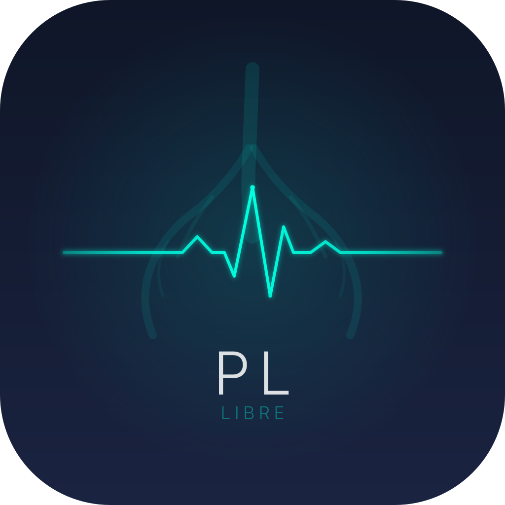
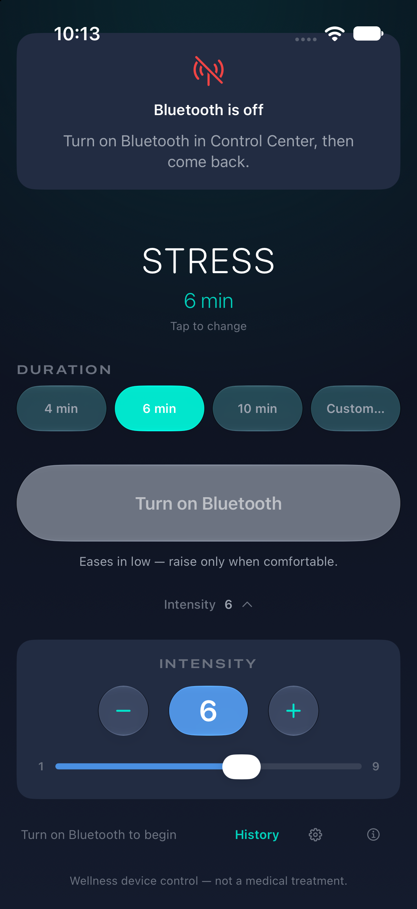

# Open Pulse

<p align="center">
  
</p>

An iOS app for the [Pulsetto](https://pulsetto.tech) neck device. Version 0.9. Needs iOS 26.

<p align="center">
  
</p>

## Why

The official app needs an account and an online login. When you are offline, or when its login service is down, you may not be able to use the device.

Open Pulse is an open alternative. It talks to the device directly over Bluetooth. It needs no account and no internet. It sends no data off the phone.

Open Pulse also adds a tapper: a left-right tick-tock sound, phone taps, or both. You can turn it on to run during the session, with the stimulation.

Open Pulse is not made by or affiliated with Pulsetto. Pulsetto is a trademark of its owner.

## What

| Feeling | Default | Pattern |
|---------|---------|---------|
| Stressed | 6 min | Both sides, steady strength |
| Anxious | 5 min | Paced breathing. Stimulation is on during the breath out. |
| Can't Sleep | 10 min | Sides change. Strength fades at the end. |
| Foggy | 6 min | Left side, 30 s on, 30 s off |
| Aching | 8 min | Strength moves in a slow wave |
| Custom | 10 min | You set it |

Optional: a session-end alert, and Mindful Minutes in Apple Health.

Not a medical treatment. Sources: [research.md](research.md).

## How

Run: open `OpenPulse.xcodeproj` in Xcode and press Run.

Test on the Mac (fast):

```bash
swift test
```

Test on the simulator (all tests):

```bash
D='platform=iOS Simulator,name=iPhone 17'
xcodebuild build-for-testing -project OpenPulse.xcodeproj -scheme OpenPulse -destination "$D" -derivedDataPath build/sim -quiet
xcodebuild test-without-building -project OpenPulse.xcodeproj -scheme OpenPulse -destination "$D" -derivedDataPath build/sim
```

## Credits

Built on [PulseLibre](https://github.com/jooray/PulseLibre) by Juraj Bednar, [hydrasparx/pulsetto](https://github.com/hydrasparx/pulsetto), and [pulse-libre](https://github.com/parallaxintelligencepartnership/pulse-libre). License: [GLWTS](LICENSE).
