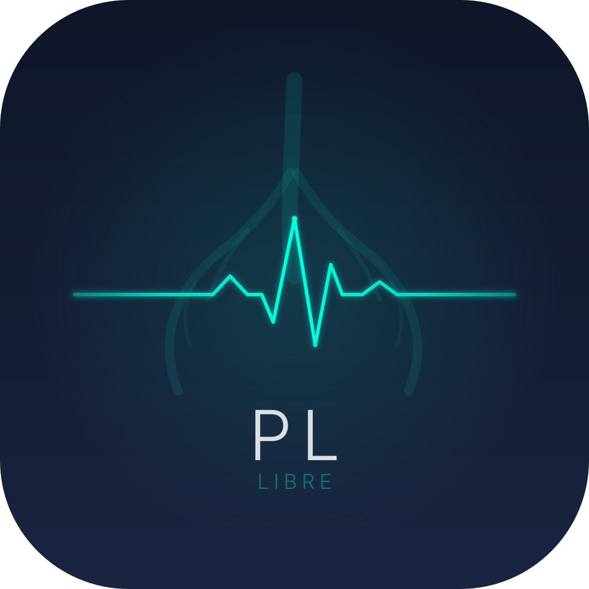
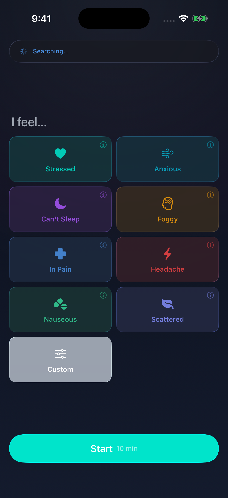
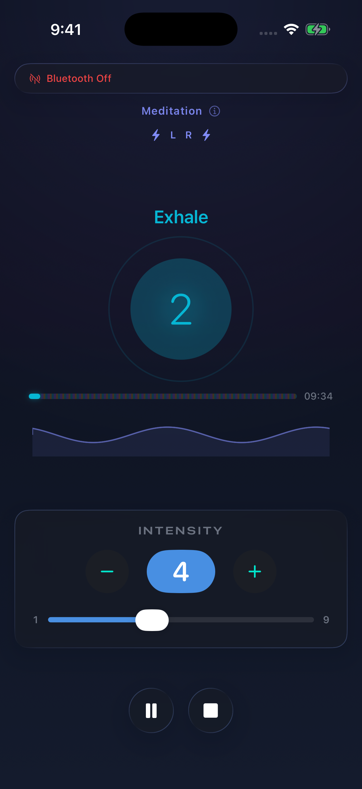

# Open Pulse

<p align="center">
  
</p>

A native iOS app for controlling [Pulsetto](https://pulsetto.tech) wellness devices over Bluetooth.

Swift 6 / SwiftUI. No dependencies. No tracking. iOS 26+.

<p align="center">
  
  &nbsp;&nbsp;
  
</p>

## Feelings

You pick a feeling. The app runs one engine. Custom stays manual.

| Feeling | Engine | Default | Behavior |
|---------|--------|---------|----------|
| **Stressed** | Stress | 6 min | Bilateral, steady intensity |
| **Anxious** | Breathe | 5 min | Exhale-gated. Pace is Calm or Meditate |
| **Can't Sleep** | Sleep | 10 min | Rotating channels, gentle fade-out |
| **Foggy** | Focus | 6 min | Left side, 30s on / 30s off |
| **Aching** | Ease | 8 min | Wave, or Burst (2 min on / 30s off) |

Older saved names still open. Learn uses Focus. Meditation uses Breathe at the Meditate pace. Head comfort uses Ease Burst. Gut comfort uses Stress.

Wellness device control only. This is not a medical treatment. Optional Mindful Minutes writes to Apple Health. The app does not read Health.

Parameter notes and citations stay in [research.md](research.md).

See [research.md](research.md) for full citations and parameter rationale.

## Building

```bash
open OpenPulse.xcodeproj
# or
xcodebuild -project OpenPulse.xcodeproj -scheme OpenPulse \
  -destination 'generic/platform=iOS' build
```

## Attribution

Built on the BLE reverse engineering from [PulseLibre](https://github.com/jooray/PulseLibre) by [Juraj Bednar](https://github.com/jooray), with additional protocol work by [hydrasparx/pulsetto](https://github.com/hydrasparx/pulsetto) and [parallaxintelligencepartnership/pulse-libre](https://github.com/parallaxintelligencepartnership/pulse-libre).

## License

[GLWTS](LICENSE)
